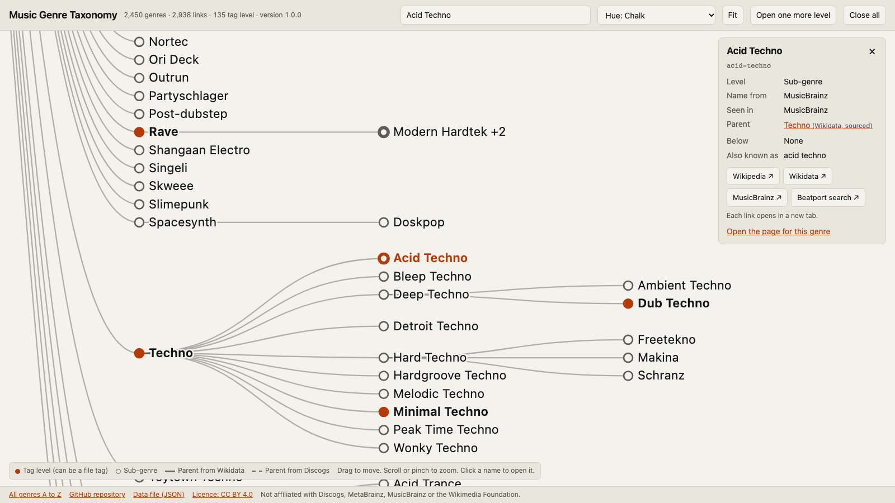

# Music Genre Taxonomy

An open music genre taxonomy: <!--count:nodes-->2,453<!--/count--> genres and subgenres in a hierarchy (a directed graph, not a strict tree). It ships as JSON and CSV with MusicBrainz, Discogs and Wikidata ids, and every parent link names its source, licence and evidence.

[](https://github.com/UniversalSyntropy/music-genre-taxonomy/actions/workflows/ci.yml)
[](LICENSE-docs)
[](LICENSE)
[](https://github.com/UniversalSyntropy/music-genre-taxonomy/releases)

[](https://universalsyntropy.github.io/music-genre-taxonomy/)

Open the [live viewer](https://universalsyntropy.github.io/music-genre-taxonomy/) to explore the genre tree in your browser.

## Start here

| I want to | Go to |
| --- | --- |
| Explore the genre tree | [Live viewer](https://universalsyntropy.github.io/music-genre-taxonomy/) and the [viewer guide](docs/viewer.md) |
| Load the data in code | [`data/taxonomy.json`](data/taxonomy.json) and the [data guide](docs/data-guide.md) |
| Open the data in a spreadsheet | [`nodes.csv`](data/nodes.csv), [`links.csv`](data/links.csv), [`aliases.csv`](data/aliases.csv), [`proposals.csv`](data/proposals.csv) (review list) |
| Validate the file | [JSON Schema](schema/taxonomy.schema.json) |
| Check sources and licences | [Sources](docs/sources.md) |
| Give an LLM the whole project | [`llms.txt`](llms.txt) or [`llms-full.txt`](llms-full.txt) |
| Report a wrong link | [Open an issue](https://github.com/UniversalSyntropy/music-genre-taxonomy/issues/new/choose) |

## Use the data

Each example reads the file from GitHub and does one task. To pin a version, replace `main` in the URL with a release tag such as `v1.0.0`.

Python (standard library only): find the parents of `acid-house`, then walk up to its tag-level ancestor. Tag level marks the depth that a file's genre tag usually uses, for example House, Techno or Ambient.

```python
import json, urllib.request
from collections import deque

URL = "https://raw.githubusercontent.com/UniversalSyntropy/music-genre-taxonomy/main/data/taxonomy.json"
data = json.load(urllib.request.urlopen(URL))

nodes = {n["key"]: n for n in data["nodes"]}
parents = {}
for link in data["links"]:
    parents.setdefault(link["child"], set()).add(link["parent"])

print("Parents of acid-house:", sorted(parents["acid-house"]))

def tag_level_ancestor(key):
    queue, seen = deque([key]), {key}
    while queue:
        k = queue.popleft()
        if nodes[k]["tag_level"]:
            return k
        for p in sorted(parents.get(k, ())):
            if p not in seen:
                seen.add(p)
                queue.append(p)
    return None

print("Tag-level ancestor of 2-step:", tag_level_ancestor("2-step"))
```

JavaScript (Node 18 or later, or a browser): resolve the tag spelling "Drum n Bass" to a genre.

```javascript
const URL = "https://raw.githubusercontent.com/UniversalSyntropy/music-genre-taxonomy/main/data/taxonomy.json";

const normal = (s) =>
  [...s.normalize("NFKC").toLowerCase().replaceAll("&", " and ")]
    .filter((c) => /[\p{L}\p{N}]/u.test(c))
    .join("");

const data = await (await fetch(URL)).json();
const byAlias = new Map(data.aliases.map((a) => [a.normal, a.node]));
const key = byAlias.get(normal("Drum n Bass"));
console.log(key, data.nodes.find((n) => n.key === key).name);
```

`curl` and `jq`: list the parents of `acid-house` with the source and evidence of each link.

```bash
curl -s https://raw.githubusercontent.com/UniversalSyntropy/music-genre-taxonomy/main/data/taxonomy.json | jq -r '.links[] | select(.child == "acid-house") | [.parent, .source, .evidence] | @tsv'
```

More recipes (children, all ancestors, alias lookup rules) are in the [data guide](docs/data-guide.md).

## What is in the data

| Item | Count |
| --- | --- |
| Genres (nodes) | <!--count:nodes-->2,453<!--/count--> |
| Parent links | <!--count:links-->4,753<!--/count--> |
| Name aliases | <!--count:aliases-->3,007<!--/count--> |
| Tag-level genres | <!--count:tag_level-->136<!--/count--> |
| Genres with no parent (roots) | <!--count:roots-->331<!--/count--> |
| Genres with no parent and no child | <!--count:isolated-->282<!--/count--> |
| Genres with two or more different parents | <!--count:multi_parent-->863<!--/count--> |
| Names from MusicBrainz / Discogs | <!--count:nodes_musicbrainz-->1,684<!--/count--> / <!--count:nodes_discogs-->766<!--/count--> |
| Links from Wikidata / MusicBrainz / Discogs | <!--count:links_wikidata-->2,036<!--/count--> / <!--count:links_musicbrainz-->1,603<!--/count--> / <!--count:links_discogs-->1,093<!--/count--> |
| Links with confidence high / medium / low | <!--count:links_high-->3,508<!--/count--> / <!--count:links_medium-->152<!--/count--> / <!--count:links_low-->1,093<!--/count--> |
| Genres with a MusicBrainz id / Wikidata id / Discogs name | <!--count:with_musicbrainz_id-->2,221<!--/count--> / <!--count:with_wikidata_id-->2,216<!--/count--> / <!--count:with_discogs_name-->766<!--/count--> |

## Sources and licences

| Source | What this repo takes | Licence |
| --- | --- | --- |
| [MusicBrainz](https://musicbrainz.org/genres) | Genre names, ids, aliases, "subgenre of" links, Wikidata links | CC0 |
| [Discogs data dumps](https://data.discogs.com/) | Genre and style names, co-occurrence links | CC0 |
| [Wikidata](https://www.wikidata.org/) | "Subclass of" links | CC0 |

CC0 does not require credit. This repo gives credit anyway. This repo's own compilation, schema, hand aliases and documents are CC BY 4.0. The code is MIT. Details and attribution text: [Sources](docs/sources.md).

## Known limits

- **Names:** simple title case, so `Edm` not `EDM`.
- **Links:** Discogs links are statistical, not editorial, so they have `confidence: low`. Wikidata "subclass of" links contain errors that this repo passes on.
- **Gaps:** <!--count:isolated-->282<!--/count--> genres have no link. Some common tag spellings have no alias yet.

The full list is in [Sources](docs/sources.md#known-limits).

## Related work

I checked that each repo exists and read its licence field on GitHub. I took no data from any of them.

| Repo | What it is (from its GitHub description) | Licence field |
| --- | --- | --- |
| [beetbox/beets](https://github.com/beetbox/beets) | Music library manager and MusicBrainz tagger. Holds `genres-tree.yaml` for its lastgenre plugin. | MIT |
| [metabrainz/genre-matching](https://github.com/metabrainz/genre-matching) | Experiments to match external genre datasets to MusicBrainz genres | none shown |
| [MTG/acousticbrainz-genre-dataset](https://github.com/MTG/acousticbrainz-genre-dataset) | The AcousticBrainz Genre Dataset | none shown |
| [FlakyBlueJay/mb-rym-hierarchy](https://github.com/FlakyBlueJay/mb-rym-hierarchy) | Rate Your Music genre hierarchy for MusicBee | none shown |
| [OliverMoscow/Categorized-Music-Genres-JSON](https://github.com/OliverMoscow/Categorized-Music-Genres-JSON) | Categorized list of music genres sourced from Wikipedia | none shown |
| [yuichkun/music-taxonomy-graph](https://github.com/yuichkun/music-taxonomy-graph) | Interactive music genre taxonomy | none shown |
| [HomoBernardus/music-genre-tree](https://github.com/HomoBernardus/music-genre-tree) | No description | none shown |
| [frankie-muller/alchemy](https://github.com/frankie-muller/alchemy) | Offline genre taxonomy, artist classifier and discovery engine | MIT |

"None shown" means GitHub reports no licence for the repo. It does not mean the data is free to use.

What this repo adds:

- Three open sources joined in one file.
- A source, licence and evidence on every link.
- External ids (MusicBrainz, Wikidata, Discogs).
- A versioned JSON Schema.
- A viewer with one static page per genre.

## Cite

Use [`CITATION.cff`](CITATION.cff). GitHub shows a "Cite this repository" button from it.

## Contribute

Found a wrong link or a missing genre? Open an issue with the form. Read [CONTRIBUTING.md](CONTRIBUTING.md) first.

## Licence

- **Data, schema and documents:** [CC BY 4.0](LICENSE-docs). Credit "music-genre-taxonomy contributors" and link to this repo.
- **Code:** [MIT](LICENSE).
- **Disclaimer:** no tie to any named service. See [DISCLAIMER.md](DISCLAIMER.md).
